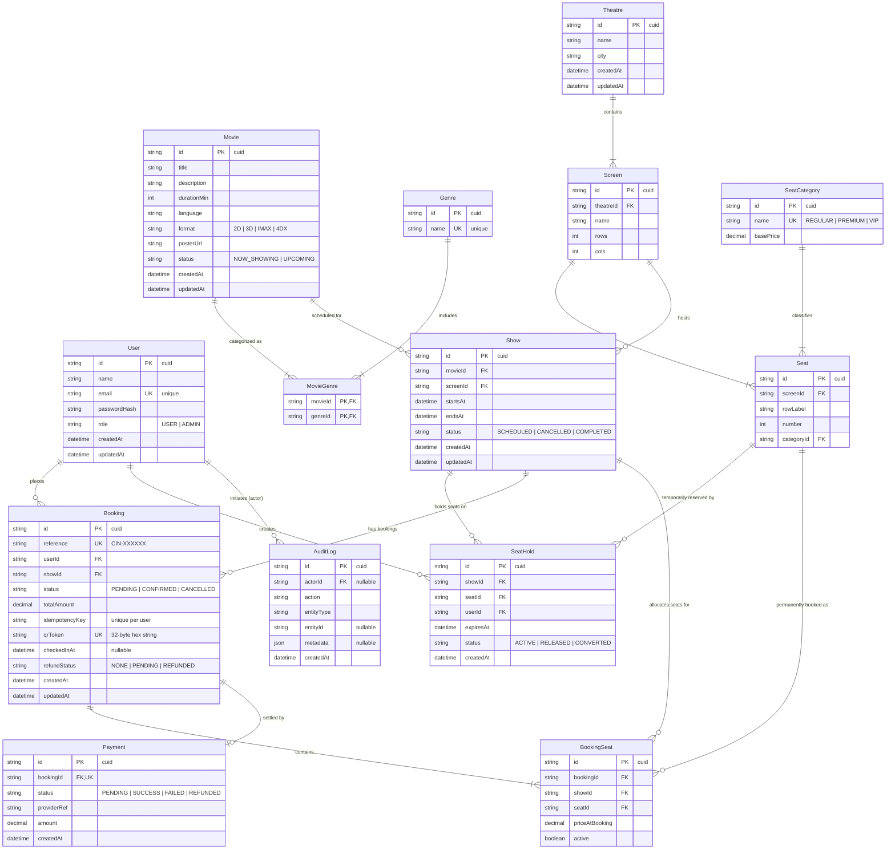

# Entity-Relationship (ER) Diagram

This document illustrates the complete data model for the Cinema Hall Ticket Booking System, implemented using PostgreSQL and Prisma ORM.



## Critical DB Constraints & Indexes

1. **Double Booking Prevention (Database-Level Guarantee):**
   - **Partial Unique Index**:
     ```sql
     CREATE UNIQUE INDEX "booking_seats_active_show_seat_idx" 
     ON "BookingSeat"("showId", "seatId") 
     WHERE active = true;
     ```
     This PostgreSQL partial index ensures that no two active booking seats can ever exist for the same show and seat concurrently, even under massive race conditions. When a booking is cancelled, setting `active = false` frees the seat instantly.

2. **Idempotency Guarantee:**
   - Unique composite constraint: `@@unique([userId, idempotencyKey])` on `Booking`.
   - Prevents duplicate payments and duplicate booking records on network retry or button double-click.

3. **Seat Map Uniqueness:**
   - Composite index: `@@unique([screenId, rowLabel, number])` on `Seat`.

4. **Show Overlap Prevention:**
   - Screen scheduling queries enforce that a new show cannot start while an existing show is still running (`startsAt < newEnd && endsAt > newStart`).

5. **Performance Indexes:**
   - `Show(startsAt)`, `Show(movieId)`, `Show(screenId, startsAt)`
   - `Booking(userId)`, `Booking(showId)`
   - `SeatHold(showId, expiresAt)`, `SeatHold(userId)`
   - `AuditLog(actorId)`, `AuditLog(entityType, entityId)`, `AuditLog(createdAt)`
